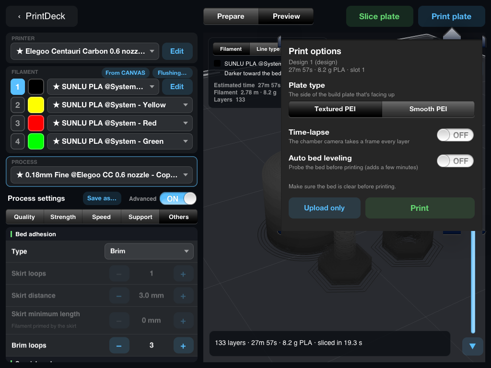
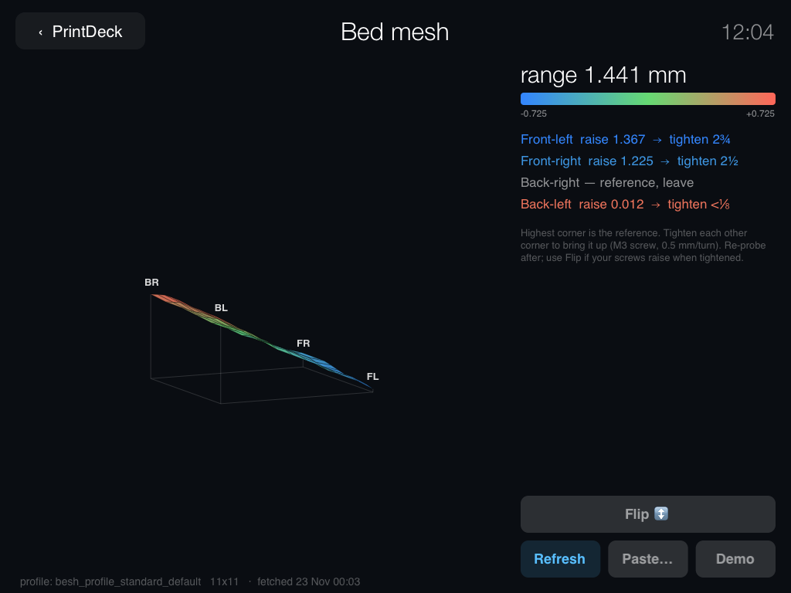
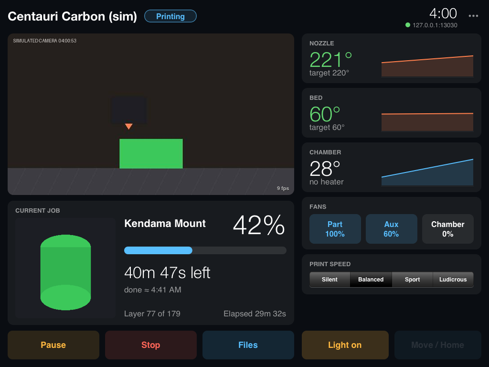

# PrintDeck

A live panel, on-device slicer and 3D modeller for an **Elegoo Centauri Carbon** (stock or OpenCentauri firmware, or OpenCentauri **COSMOS** — Klipper +
Moonraker, detected automatically; see [docs/COSMOS.md](docs/COSMOS.md)) on the iPad 1 (iOS 5.1.1).
It shows the camera, the current job (thumbnail, %, layer, time left, finish time, and a rotatable **3D view of
the part's toolpath** with the printed layers), nozzle/bed/chamber temperatures with smooth live graphs, and fans. It lets you pause/resume/stop, start prints from the printer's
file list, set temperatures, fans, print speed and the light, and move/home axes. When a print finishes,
fails or pauses by itself, it shows a full-screen alert and plays a sound. It also **slices STL files on the
iPad** with four CANVAS filament slots ([Slice](#slice)), has a Tinkercad-style **Design** page with handy test
models ([Design](#design)), and shows the **bed mesh** in 3D ([Bed mesh](#bed-mesh)).

**What it adds over the printer's web page and ElegooSlicer**, with screenshots of each page:
[docs/FEATURES.md](docs/FEATURES.md). Downloads are on the [Releases](https://github.com/jeparks808/PrintDeck/releases)
page; see [CHANGELOG.md](CHANGELOG.md) for what changed.

**Contents:** [How it works](#how-it-works) · [Move / Home](#move--home) · [3D toolpath viewer](#3d-toolpath-viewer) ·
[Slice](#slice) · [Design](#design) · [Bed mesh](#bed-mesh) · [Using it](#using-it) ·
[SDCP commands used](#sdcp-commands-used) · [Build and install](#build-and-install) · [Simulator](#simulator) ·
[Security note](#security-note) · [License](#license) · [Credits](#credits)

**Pause** and **Stop** sit in the top bar above the camera. The left column is the camera with the **CANVAS
card** beside it (the four slots of Elegoo's filament changer: colour, type, brand, which slot is feeding), a compact **job
card** (thumbnail, name, one status line with time left and finish time, progress, layer/elapsed), the
**Design** card beside it (opens the [Design](#design) page), and a **Files card**: the printer's G-code files,
each with its picture, beside a small **3D preview** of the one you tap (drag to rotate, pinch to zoom, double-tap to reset), with
a **Print** button (asks first, disabled while busy) and an **Inspect** button that opens the **File** page.
A file's picture comes from the printer (`/thumbnail/<file>.png`, which exists only for files it has printed)
or else from the slicer's PNG in the G-code header (a 96 KB Range request). Pictures of dark filament are
brightened, and all are cached in `Library/Caches/PrintDeckThumbs`. See [3D toolpath viewer](#3d-toolpath-viewer).

**Every card opens a full-screen detail page** — ‹ PrintDeck (top left) or a swipe to the right goes back:
- **Nozzle / bed / chamber**: a big reading, a large smooth graph with min/max/avg over the last minute, and
  quick temperature presets. The **Bed** page also has a **Bed mesh** button (see [Bed mesh](#bed-mesh)).
- **Camera**: a large live feed, fps, pause.
- **CANVAS** (`printdeck://page?name=canvas`): a big tile per slot (spool in its colour, type, brand, hex
  colour, nozzle range, "FEEDING THE NOZZLE" on the active one) plus connected / feeding / auto-refill / loaded
  tiles. Read-only: see [SDCP commands used](#sdcp-commands-used) for why slots are set on the printer's screen.
- **Job**: a **3D toolpath view** of the part being printed (or the last one printed) with the printed layers
  coloured and the current layer highlighted, plus progress, layer, elapsed/left/finish, speed, and pause/stop
  (or the last job's outcome). See [3D toolpath viewer](#3d-toolpath-viewer).
- **Fans**: the three fans with live readings and sliders.
- **Print speed**: Silent/Balanced/Sport/Ludicrous with descriptions, the live %, and a custom % slider.
- **File** (the Files card's **Inspect**, or `printdeck://page?name=file`): the selected file in detail — the
  big 3D viewer with the layer slider (step through the layers to inspect the part), its thumbnail, the
  printer's slicer details (`Cmd 260`: estimated time, filament weight, colours), layers, height, size,
  footprint on the bed, upload date and when it was last printed, the full file list (tap a file to inspect
  it; the Files card follows), and **Print this file**.
- **Move / Home** (the Move / Home button): a **live camera**, per-axis jog rows (position, −/+, its own step
  sizes), Home X/Y/Z and Home all, status tiles (nozzle/bed/chamber temperature and target, the three fans,
  motor drivers, Z offset, speed), Preheat PLA/PETG and Cool down, the light, and the stored files to print.


| Slice: 4 CANVAS slots and print options | Design: handy models |
|---|---|
|  |  |

| Bed mesh | Printing (simulator) | Finished alert (simulator) |
|---|---|---|
|  |  |  |

## How it works
```
Centauri Carbon (192.168.0.185)                            iPad: PrintDeck.app
  UDP 3000   "M99999" discovery  ◄──── broadcast on launch ── finds the printer by itself
  TCP 3030   SDCP websocket      ◄──── Cmd 0 status every 2 s; commands
  TCP 3031   /video MJPEG        ────► camera (~8 fps, 640x360)
  TCP 80     history thumbnails  ────► job picture
  TCP 80     /local/<file>.gcode ────► 3D toolpath (streamed and parsed on the iPad)
```
- **No computer needed.** The iPad talks to the printer directly over Wi-Fi, in plain HTTP/websocket, so iOS 5's
  old TLS doesn't matter.
- **Websocket by hand.** iOS 5 has no websocket API, and Safari 5.1 only speaks an old draft, so
  `PDWebSocket.m` implements RFC 6455 (handshake, masking, framing) over CFStream sockets.
- **Polling.** The printer doesn't push status while idle, so the app sends SDCP `Cmd 0` every 2 s. No reply
  for 8 s → reconnect. Brief Wi-Fi blips don't bring up the "offline" screen.
- **Camera.** JPEG frames are cut out of the MJPEG stream and decoded off the main thread. Frames that arrive
  while a decode is running are dropped, so the A4 never falls behind. The printer allows 4 video viewers at
  once; the app opens one and closes it when the iPad sleeps or the app is in the background.
- **Temperature graphs.** The three readings are sampled once a second into `PDPrinter`'s own ring buffers and
  drawn by `PDSparklineView` (ported from DeskDash) on a compressed time axis — four quarters holding the last
  4 s, 8 s, 16 s and 32 s, so recent change is wide and older data squeezed — scrolling smoothly at ~20 fps
  between samples with a Hermite curve, grid included. Because an idle nozzle sits near ambient, the graphs
  auto-range **both** ends of the scale to the data (with a floor on the span so a steady reading stays a calm
  line, not magnified noise) and ease to new heights instead of jumping. `PDGraphClock` runs the display a
  little behind the newest sample so motion is steady.
- **Time left** blends the slicer's estimate with a progress-based one that takes over as the print goes on
  (on this printer a "2h18m" slice took 3h42m).
- The last printer found is remembered. The screen stays on, landscape, no status bar.

## Move / Home
The left half is the live camera (tap it to pause/resume; the dashboard's own camera stops while any
full-screen page is open, so the A4 decodes one stream at a time) over a grid of status tiles; the right
half has one row per axis and the stored files.
- **Jog**: each axis has its own step sizes — X/Y 0.1 / 1 / 10 / 50 mm, Z 0.05 / 0.1 / 1 / 10 mm — and remembers
  the one you picked. The position (`Status.CurrenCoord`) updates with the next status poll.
- **Home** X, Y, Z or all (`Cmd 402`). Jog, home, preheat and the file list are disabled while a job runs.
- **Tiles**: nozzle/bed/chamber temperature (with the target, orange while heating, green once there), part/aux/
  chamber fan %, **motors** (`Attributes.DevicesStatus.{X,Y,Z}MotorStatus`, 1 = OK; the page re-asks for the
  attributes every 6 s, since the printer only sends them on request), `ZOffset`, and print speed.
- **Preheat PLA** (210°/60°), **Preheat PETG** (240°/70°), **Cool down** (both heaters off), and the light.
The SDCP API has no motors-off, extrude/retract or Z-offset command (checked against the commands the
printer's own web UI knows), so those aren't offered.

## 3D toolpath viewer
The Job page draws the job's G-code as lines you can rotate (drag), zoom (pinch) and reset (double-tap or
**Reset view**). The view opens fitted to the part, drawn on the Centauri Carbon's real plate (its shape,
tabs and all, from ElegooSlicer's bed model, generated into `PDBedShape.h`; the brighter square is the 256 mm
printable area); pinch out to see the whole plate. While a job runs, the printed layers are drawn in the
**filament's own colours** — each `T<n>` part of a multi-colour (CANVAS) file in its colour from the file's
`; filament_colour = #RRGGBB;…` list, the same list the printer uses — shaded in ten steps from darker at the
bed to the true colour at the top (files with no colours fall back to blue → orange by height), with a depth
cue, the layer printing now is bright green, and the layers still to come are a faint ghost; the label
shows the layer and Z. With nothing printing it shows the last job (a stopped job shows where it stopped).
Drag the **layer slider** to step through the layers; **Follow print** / **Show all** goes back.

- **Where the file comes from.** The printer's port-80 web server shares `/local/`, so the app fetches
  `http://<printer>/local/<file>.gcode` itself — no helper. The file is `PrintInfo.Filename` while printing,
  else the newest history entry's `TaskName`.
- **Kept small for the iPad 1.** `PDToolpath.m` streams the download through a C parser on a background
  thread (it never holds the file). It keeps only the extrusions that show the part's surface — `;TYPE:`
  outer walls, overhang walls, skirt and brim (every extrusion if the file has no `;TYPE:` comments) —
  splits layers on `;LAYER_CHANGE` / `;Z:` (or Z rising, for other slicers), turns `G2`/`G3` arcs into short
  chords, and merges moves into segments of at least 0.4 mm. Past 110,000 segments it halves the path
  (joined pairs merge, the minimum length doubles). Segments are int16 in 0.01 mm, 12 bytes each. Parsed
  paths are cached on the iPad, see *Caching* below.
- **Caching: one file per viewer.** There are two loader slots, `job` (the Print job page: the running or
  last job) and `files` (the Files card and the File page: the last file you picked in either). Each keeps exactly one parsed toolpath
  in `Library/Caches/toolpaths/<slot>.tp` (about 0.1–1.3 MB); tapping another file downloads and parses it and
  replaces (deletes) the previous one. A slot that wants the file the other slot already has shares it (in
  memory, no download) or waits for the other's download instead of starting a second one. The raw G-code is
  never stored. The Files card remembers its selection per printer address, so after a relaunch the preview
  comes straight from the cache.
- **Rendering.** OpenGL ES 2.0 through GLKit: one VBO of `GL_LINES`, a tiny shader, 4× multisampling, drawn
  only when something changes, so it costs nothing while you just watch.
- **Measured on the iPad 1** (real printer and simulator): a 6.9 MB file → 291 layers, 69k segments in 4.0 s
  with the dashboard camera stopped, ~9–12 s from the dashboard's Files card while its camera streams;
  a 14.6 MB file → 348 layers, 82.5k segments in 10.4 s (through the simulator's SSH tunnel). Spinning that
  one continuously runs at **~21 fps**; CPU is ~1–3 % when it's still; the whole app stays near 18 MB RSS.
  The Move / Home page with its camera at 10 fps uses ~30–35 % CPU (camera frames are no longer resampled on
  the CPU unless the view is under half their size — the GPU scales them — which took this page from ~52 %).
- If the printer's layer count differs from the file's, the current layer is scaled to match.

## Slice
Slice models **on the iPad** and send them to the printer. Open it with **Slice…** on the Files card (or
`printdeck://slice`). The page has:
- **Model…**: built-in test shapes (calibration cube, cylinder, sphere, support test), or any STL (binary
  or ASCII, up to 400k triangles) in `/var/mobile/Documents/PrintDeck`. Swipe a file to delete it. An STL
  sent with **Open in PrintDeck** from Safari or Mail is moved there and opened. iTunes File Sharing doesn't
  reach /Applications apps, so copy files in over SSH (`su mobile -c mkdir` the folder first).
- **Placement**: Turn left/right (Z), Tip forward/sideways (quarter turns about X/Y), Scale −/+ and Reset.
  These are remembered, along with the model. The model turns red when it doesn't fit the 256 mm bed.
- **Presets, laid out like ElegooSlicer / Orca.** The left column has **Printer**, **Filament** (the four CANVAS
  slots, see below) and **Process** combos holding ElegooSlicer's stock Centauri Carbon profiles (4 nozzles, 21 processes,
  36 filaments) plus your own: **Save as…** stores the current printer, filament or process settings as a user
  preset (filament and process presets belong to a printer; swipe one to delete it). An edited preset reads
  "(modified)". The stock profiles are bundled by `tools/make-profiles.py` (the iPad 1 can't reach GitHub's
  TLS), which resolves ElegooSlicer's `inherits` chains and maps the values onto PrintDeck's settings; rerun it
  and rebuild to pick up newer ones.
  `tools/import-user-presets.py` does the same for the **user presets** saved in ElegooSlicer and OrcaSlicer on the
  build computer (`~/.config/{ElegooSlicer,OrcaSlicer}/user`, resolved through each slicer's own system profiles,
  filament colours included) into `Resources/ImportedPresets.plist`; the app adds them to its user presets once
  ("From ElegooSlicer" in the lists; one you delete stays deleted). Presets for other printers (the Centauri
  Carbon 2) are skipped.
- **Filament slots (CANVAS).** The Filament panel has four numbered rows, one per CANVAS slot, each with a colour
  swatch and a filament preset. The highlighted number is the slot the model prints with; its **Edit** button
  is the Filament editor. Tap another number to print with that slot (its preset, or the stock "Generic
  <type>" for a slot that only names a material, and its colour are loaded). **From CANVAS** copies each loaded
  slot's type, colour and name from the printer (`Cmd 324`). The start G-code loads the chosen slot as
  ElegooSlicer does (`M6211 A1 L200 T<n> …`, then `T<n>`), and the config block lists all four slots.
  Slots and the print slot live in `PDFilaments.m`.
- **Flushing…** (Filament panel): ElegooSlicer's flushing-volume table, mm³ purged when the CANVAS switches
  from one slot (row) to another (column), and a multiplier; ElegooSlicer turns each into `M6211 … L<mm>` =
  volume × multiplier ÷ the filament's cross-section. **Calculate from colours** (or **Follow the slot
  colours**) uses ElegooSlicer 1.5.3.5's own rule (`FlushVolCalculator::calc_flush_vol`, recovered from its
  Linux binary): measured values for its standard colour pairs, else a brightness and hue/saturation distance
  model, 60–800 mm³. The table starts with the values from an ElegooSlicer 4-colour file. CuraEngine 15.04
  slices one material, so a model prints from one slot and the table is written into the file for reference.
- **Settings**: every setting CuraEngine 15.04 uses for a single-extruder printer, under the active editor's
  tabs — Process: Quality / Strength / Speed / Support / Others; Filament (**Edit**): Filament / Cooling;
  Printer (**Edit**): Extruder. The **Advanced** switch shows the rest, as in Orca. Choices with more than two
  options are dropdowns (e.g. sparse infill pattern: Auto, Grid, Lines, Concentric, **Gyroid**). Gyroid is
  PrintDeck's addition to the engine: each layer's cross-section of the gyroid surface, computed analytically.
- **Prepare / Preview** tabs. Preview shows the result in the filament colour (or by line type, or by height,
  with Orca's line-type legend), a vertical layer slider and the totals.
- **Slice plate** shows progress by phase, then layers, print time, filament and grams. The result is marked
  stale when the model or the settings change.
- **Print plate** opens **Print options**, the choices the printer's own start screen offers: **plate type**
  (Textured PEI or Smooth PEI), **time-lapse** and **auto bed levelling** (remembered for next time; sent in
  `Cmd 128`), then **Print** (upload and start) or **Upload only**. On COSMOS the options are ignored. Files are
  named `ECC_<nozzle>_<model>_<material>_<layer>_<time>.gcode`, carry a 144 × 144 thumbnail of the model in the
  filament colour for the printer's screen, and are selected in the Files card.

**Engine.** [CuraEngine 15.04.6](https://github.com/Ultimaker/CuraEngine/tree/15.04) (C++, **AGPL-3.0**)
is vendored in `engine/CuraEngine` with a small patch (`engine/printdeck.patch`, against the 15.04.6 tag: Cura-style
`;LAYER:`/`;TYPE:` markers and gyroid infill, with Clipper's open-path clipping turned on). `engine/build.sh` cross-compiles it for armv7/iOS 5 with clang and libc++, then signs it
with ldid. `make` runs it incrementally and bundles the binary as `PrintDeck.app/CuraEngine`. PrintDeck
runs it with `posix_spawn`, reads its `Progress:` lines, and wraps the output in ElegooSlicer-style header
comments. The printer lists layers/time/weight only when the `; generated by` line says ElegooSlicer. The
start and end G-code match Elegoo's profile for the Centauri Carbon. Distributing PrintDeck with the
engine means offering the engine source (it's in this repo) under the AGPL.

Measured on the iPad 1 (A4, camera paused while slicing):

| Model | Settings | Slice time | Result |
|---|---|---|---|
| Support test | support, brim, 30 % infill | 3.4 s | supports in the preview |
| 40 mm sphere (20k triangles) | defaults (0.24 mm, 15 %) | 14.3 s | 166 layers, 29 min, 12.9 g |
| 40 mm sphere | 0.30mm Standard, 15 % gyroid | 12.5 s | 133 layers, 25 min, 13.4 g |

The upload was checked against the printer, which read 166 layers, 1766 s and 12.91 g from the file. Designs
sliced on the iPad have printed on the real printer (a bolt, nut and cap: 65 layers in 10 min on 22 Nov 2026,
and a 133-layer version on 23 Nov). Not yet checked on a real print: that the levelling and time-lapse options
take effect, and starting from a CANVAS slot other than 1.


## Design
A small Tinkercad-style modeller (native, OpenGL ES 2.0; tinkercad.com itself needs WebGL, which iOS 5 lacks).
Open it from the **Design** card (or `printdeck://design[?name=<design>]`).
- **Shapes** (left): box, cylinder, sphere, half sphere, cone, pyramid, roof, wedge, tube, torus, plus box and
  cylinder **holes**. A tap drops one at the middle of the view, on the plate.
- **Library** (the palette's second tab): parts made from parameters, in a popover (‹ › and −/+ steppers,
  tap a number to type it; the last values are remembered per part):
  - **Bolt**: M2–M12, length, hex / socket / flat (countersunk) head or a plain threaded rod, threaded or not,
    clearance. Stands on its head so it prints head down.
  - **Nut**: M2–M12, standard / thin / thick, threaded or a plain hole, clearance.
  - **Threaded hole**, **Screw hole** (countersink / counterbore / plain clearance hole) and **Rounded hole**
    (filleted or chamfered rim, at the top or both ends): holes, so group them with what they should cut.
  - **Rounded box** and **Round cylinder** (fillet or chamfer edges) and an involute **Gear** (teeth, module,
    thickness, bore).
  Threads are ISO metric 60° (right-handed); clearance per side shrinks outside threads and grows inside ones
  (0.15–0.25 mm suits FDM). The geometry is `PDParts.c`: threads are zipped column by column round the axis and
  bolts/nuts are stitched in one piece, so every part is a closed mesh without boolean operations (an M5 × 20
  bolt is about 8,500 triangles). **Edit part…** in the inspector changes a placed part's parameters (it keeps its
  place, turn and colour).
- **Models…** (last Library tile): brings an STL or OBJ into the design as a shape — your **saved parts**
  (`Documents/PrintDeck/Library`), the **handy models** (below) or the **models on the iPad** (the Slice page's
  STLs) — or **downloads** one from
  a direct link (plain http works best; iOS 5 can't reach many HTTPS sites). Swipe to delete. **Save part…** in the
  inspector writes the selected shape (a group, a part, anything) to the Library as an STL. Imported meshes are kept
  once in `Designs/Meshes` and shared by copies; very big ones (over ~60k triangles) group slowly.
  **Handy models**, bundled in `Resources/HandyModels`: an overhang test (fins at 20°–70°), the KSR FDM
  all-in-one test, the Elegoo and Orca test cubes, the Voron design cube, Elegoo and Orca tolerance and stringing
  tests, Calicat and the Stanford bunny (from ElegooSlicer's `resources/handy_models`; see [Credits](#credits)).
- **Workplane** (centre): the 256 mm plate with a 10 mm grid. Tap a shape to select it, drag it to slide it
  (snapped to the snap grid), drag empty space to orbit, two fingers to pan, pinch to zoom, double-tap to fit.
  **Select more** (on the canvas and in the inspector) makes taps add to or remove from the selection.
  **Slide | Move XYZ | Rotate | Scale** (top right of the canvas), as in Orca Slicer:
  - **Move XYZ** puts red/green/blue arrows on the selection. Drag one to move along just that axis, Z included,
    snapped to the snap grid. While you drag:
    - A ruler runs along the axis from where you started, with 1, 5 or 10 mm ticks depending on zoom and every
      10 mm labelled.
    - A yellow bar shows the distance moved, and the distance (e.g. "X +26 mm") sits by the arrow and at the
      bottom of the view.
  - **Rotate** puts three rings round the selection's centre. Drag one to turn about that axis. A Tinkercad-style
    protractor appears:
    - The ring's disc is cut into 30° pie slices, labelled 0°, ±30° … 180° from where the drag started. With
      your finger inside the disc (close to the centre), the turn snaps to those slices.
    - Drag out beyond the disc and it turns freely in 1° steps: the disc dims and 5° rim ticks appear.
    - A yellow wedge and label show the turn so far, and the bottom readout says which mode you're in.
    - A selection standing on the plate stays on it.
  - In Rotate mode, a **Rotation X … Y … Z …** readout (top left) always shows the selection's turn from its
    original axes; the inspector's TURN caption shows it too.
  - **Reset rotation** turns each selected shape back onto its own original X/Y/Z axes about its centre, keeping
    its size and mirroring.
  - **Scale** (one shape at a time; a group scales as a whole) puts a cube handle on each of the shape's own
    axes. Drag one to stretch that way; the size updates live. The inspector's SCALE section has X / Y / Z %
    boxes (relative to the size when Scale was picked, 0.1–200 %, typed values are clamped) with −/+, and a
    **Uniform** toggle that keeps the proportions (one handle or box scales all three). Fillets stay in mm,
    shapes standing on the plate stay on it, and every change is undoable and saved.
  - Dragging the shapes themselves still slides them in every mode.
- **Shape options** (**Options…** in the inspector, for the basic shapes):
  - **Box**: fillet or chamfer (size in mm) on all edges, all but the bottom four (prints flat), or just the
    upright ones.
  - **Cylinder**: sides (smooth, or 3–16 for prisms), top and bottom edge fillet or chamfer.
  - **Cone**: sides, and a flat-top diameter (a frustum).
  - **Tube**: wall thickness, sides, rim fillet or chamfer at the top or both ends.
  - **Pyramid**: 3–16 sides. **Sphere / half sphere**: smoothness.
  - **Torus**: tube diameter (which is also its height), sides, tube smoothness.
  - The mesh is remade in mm whenever the shape is resized, so a 2 mm fillet stays 2 mm (`PDShape*` in
    `PDParts.c`).
  - Roof and wedge have none, because their sloped faces meet at angles a simple fillet or chamfer can't follow.
- **Pick shapes…** (inspector): a list of every shape with checkmarks (All / None); tap rows to choose what to
  group, then **Group N** right there.
- **Inspector** (right): Solid/Hole, colour, size (W/D/H), position (X/Y centre, lift), turn about Z/X/Y in
  15/45/90/5° steps (tap the step to change it), Duplicate, Delete, Group, Ungroup, Mirror, Drop to plate.
  With two or more selected, **Align** lines them up to the selection's box (X: left/centre/right, Y:
  front/centre/back, Z: bottom/middle/top), **Space evenly ↔/↕** gives equal gaps between three or more
  (the outer two stay put), and **Arrange in a grid…** lays them out in rows of about √n from the
  selection's front-left corner, touching or with 2/5/10 mm gaps (columns as wide as their widest shape,
  rows as deep as their deepest, each shape centred in its cell). Tap a
  value to type it. With nothing selected: help, the snap grid (0.1/0.5/1/5 mm), Select all, Fit view.
- **Holes cut only inside a group**, as in Tinkercad: select a hole and the shapes it should cut, then Group.
  Grouping runs a BSP CSG (`PDCSG.c`: union of the solids minus union of the holes, welded and
  T-junction-mended so the result is watertight). The BSP picks each splitting plane from a dozen candidates
  (fewest polygons cut, best balance), which keeps curved meshes from shattering: a 20 mm block minus an M6
  threaded hole comes out at about 25k triangles in 0.1 s on a PC (a few seconds on the iPad 1). Ungroup gives the members back.
  The CSG runs on a background thread (16 MB stack) with a **progress bar** ("Combining shapes… step k of n"),
  so the page stays responsive. A group's result is saved with the design (`Designs/Meshes/<uuid>.mesh`), so
  opening a design doesn't redo its CSG: a design that took about 3.5 minutes to open now opens in under 9 s.
- **Designs** saves as you go (`Documents/PrintDeck/Designs/<name>.pddesign`, a binary plist); the Designs menu
  has New, Open…, Duplicate, Rename and Delete. Undo/Redo keep the last 40 steps.
- **Send to slicer** writes the solids' union as `<name> (design).stl` with your STLs and opens it on the Slice
  page (it warns about holes that aren't grouped with anything).
## Bed mesh
A rotatable 3D height map of the bed, with hints for tramming the **4 spring-loaded corner screws**. It is drawn to
scale on the Centauri Carbon's real plate (outline from `PDBedShape.h`, plus the 256 mm printable square). The probed
area sits at its real position (`mesh_min`..`mesh_max`), with one grid line and one dot per probe point. The panel
states the probe count, spacing and X/Y range ("11 × 11 probe points, every 22.6 mm · X 20–246 mm, Y 20–246 mm"), and
the view opens from the front-left, as you stand at the printer.
Open it from the **Bed** detail page's **Bed mesh** button or `printdeck://mesh`. Drag the model to
rotate, pinch to zoom, double-tap to reset; ‹ PrintDeck or a swipe off the model goes back. The panel
names the highest corner as the reference and, for each other corner, the rise needed and the screw
turn (default M3, 0.5 mm/turn; **Flip** inverts tighten/loosen if your screws raise when tightened).
Re-probe after adjusting. Rendering is a small software-3D painter's-algorithm surface in Core
Graphics (`PDMeshView.m`) — no OpenGL — shaded on a diverging blue→green→red scale around the mean.

Open it from `••• → Bed mesh`, the **Bed** detail page's **Bed mesh** button, or `printdeck://mesh`.

**Getting the mesh.** OpenCentauri-*patched* firmware is a monolithic Klippy with **no Moonraker, no
network Klipper API, and no SDCP mesh command** (the Elegoo web UI only shows a leveling *status*), but
it **saves its bed meshes as Klipper `[bed_mesh …]` profiles** in `/board-resource/user_printer.cfg`
(and `printer.cfg`) — a single-line `points :` grid with `x_count`/`y_count` and `mesh_min`/`mesh_max`
pairs. PrintDeck reads a mesh from, in order (`PDMesh.m`):
- the **`meshbridge` helper** (`meshbridge/` — a tiny Python3 service, run on the printer, that reads
  those cfg files and serves the mesh as JSON): set `PDMeshSource.helperURL` via
  `printdeck://mesh?helper=<url-enc>`, then **Refresh**;
- a mesh you **paste** (a `[bed_mesh]` block copied over SSH, a `BED_MESH_OUTPUT` dump, or JSON);
- the cached last mesh, or a built-in **Demo** mesh for previewing the view.
It also parses a Moonraker `bed_mesh` object unchanged, so a COSMOS printer works directly. The page fetches
again on its own about 8 s after the printer finishes levelling, and its footer says where the mesh came from
and when ("fetched 23 Nov 00:03", "pasted …", "demo mesh"), in amber when the last fetch failed.

**Installing the helper:** `tools/install-meshbridge.sh [printer-ip]` (asks for the printer's root password
once) copies it to `/kip/share/meshbridge/` and adds `/kip/etc/init.d/S90meshbridge`, which OpenCentauri's
boot script starts at every power-on (Kipware's `rc.unslung`) and which restarts the helper if it exits. Both
live on the persistent `/user-resource` partition, so they survive reboots and firmware updates;
`--remove` undoes it. See [meshbridge/README.md](meshbridge/README.md).

## Using it
- **Temperature cards** (nozzle, bed): tap for presets or a custom value. The chamber has no heater.
- **Fans**: tap Part / Aux / Chamber for 0–100 %.
- **Print speed**: Silent 50 %, Balanced 100 %, Sport 130 %, Ludicrous 160 % (Elegoo's presets; only while printing).
- **Files** (dashboard card): the printer's stored G-code, newest first; tap one to preview it in 3D, then
  **Print** (asks first; disabled while busy). Move / Home also lists them (tap to print).
- **Move / Home**: live camera; jog each axis with its own step size, home one axis or all, preheat/cool down;
  disabled while a job runs (see [Move / Home](#move--home)).
- **••• menu**: camera on/off (saves Wi-Fi and CPU), find printer, enter an address, reconnect, Bed mesh, and
  **Clear local cache…** (thumbnails, parsed toolpaths unless a job is running, slicer scratch files, and the
  Design page's in-memory part and model caches).
- **3D previews while printing**: the printer's web server answers every file download with HTTP 500 "device
  busy" while a job is being prepared or printed, so a file that isn't cached yet shows a note saying so and
  loads by itself once the printer allows it (PrintDeck retries every 20 s).

## SDCP commands used
From [OpenCentauri's API notes](https://docs.opencentauri.cc/software/api) and the printer's own web UI (port 80),
checked against the printer (SDCP V3.0.0, firmware V1.4.49):

| Cmd | Use | Data |
|---|---|---|
| 0 / 1 | status / attributes (attributes carry `DevicesStatus` motor state, `CameraStatus`) | — |
| 128 | start print | `Filename`, `StartLayer`, `Calibration_switch` (1 = level first), `PrintPlatformType` (0 textured, 1 smooth), `Tlp_Switch` (1 = time-lapse) |
| 129 / 130 / 131 | pause / stop / resume | — |
| 258 | file list | `Url: "/local"` |
| 259 | delete files | `FileList: ["/local/…gcode"]`, `FolderList: []` |
| 260 | file details (`EstTime`, `EstWeight`, `Thumbnail`, `ColorMapping`; the reply doesn't name the file) | `Url: "/local/…gcode"` |
| 320 / 321 | history ids / task details (thumbnail URL, outcome, `ErrorStatusReason`) | `Id: [...]` |
| 324 | CANVAS slots: `active_canvas_id`, `active_tray_id` (−1 none), `auto_refill`, `canvas_list[].tray_list[]` (`brand`, `filament_type`, `filament_name`, `filament_color`, `min/max_nozzle_temp`, `status` 1 loaded); asked on connect, when `AmsConnectStatus` changes, and every 10 s (4 s while printing) | — |
| 401 | jog | `Axis`, `Step` (mm, negative = minus) |
| 402 | home | `Axis`: `X` `Y` `Z` `XYZ` |
| 403 | set | `TempTargetNozzle`, `TempTargetHotbed`, `PrintSpeedPct`, `TargetFanSpeed{ModelFan,AuxiliaryFan,BoxFan}`, `LightStatus{SecondLight,RgbLight}` |

Uploading (the Slice page) is HTTP, not a command: `POST http://<printer>:3030/uploadFile/upload`, multipart
with `Check=1`, `S-File-MD5` (of the whole file), `Uuid`, `Offset`, `TotalSize` and `File`, in chunks of at
most 1 MiB. Each chunk answers `{"code":"000000"}`. Uploading the same name again overwrites the file.

**No CANVAS slot write over the network (checked 2026-11-22).** The printer's touchscreen sets a slot's
filament and colour inside the `app` process, but nothing exposes that: the web UI's command enum stops at
`324 GET_MATERIAL_DATA` (plus `503 GET_FILE_COLOR_DATA`), Elegoo's own `elegoo-link` library maps only 324 for
the CC1 (its CC2 adapter has method 2003 "write canvas filament", over MQTT, not SDCP), the OpenCentauri 0.5.0
patches add none, and no community client (Home Assistant, TigerTag, pycentauri, filament-rfid-writer) writes
slots. Unknown command numbers are not probed: one SDCP command is known to have crashed a CC1.

`PrintInfo.Status` on this printer (from the web UI): 0 idle · 1, 15, 16 (heating), 18–21 (20 = leveling) preparing ·
13 printing · 5 pausing · 6 paused · 7 stopping · 8/14 stopped · 9 complete · 10 file check · 12 power-loss recovery.

Tested on the real printer: discovery, status, camera, files, history/thumbnail, the light command (on/off
read back correctly), the Move / Home page's camera and tiles, and the 3D view of the last job.
Pause/resume/stop/start, temperatures, fans, speed, moves/homing/preheat and the live layer progress in the
3D view were exercised against the simulator only, since they would interrupt, move or start the real printer. They use the same payloads as Elegoo's web UI.

## Build and install
Needs [Theos](https://theos.dev) with the iPhoneOS 9.3 SDK (the app targets armv7, iOS 5, ARC). From the
repo root:
```bash
make package install          # over USB: needs `iproxy 2222 22` running
THEOS_DEVICE_IP=ipad-wifi make package install    # over Wi-Fi
make package FINALPACKAGE=1   # a release .deb in packages/
```
`make` also rebuilds `engine/` (CuraEngine) when its sources change.
URL scheme (handy over SSH: `ssh ipad "su mobile -c 'uiopen printdeck://…'"`):
`printdeck://connect?host=IP[&port=3030&video=3031]`, `printdeck://search`, `printdeck://camera?on=0|1`,
`printdeck://event?kind=finished|paused|failed` (preview the alert), `printdeck://card?name=nozzle|bed|chamber`
(open a temperature detail page), `printdeck://page?name=camera|job|file|fans|speed|machine|canvas` (open a card detail
page), `printdeck://mesh[?helper=<url-encoded JSON endpoint>]` (open the 3D bed mesh),
`printdeck://design[?name=<design>]` (open the Design page),
`printdeck://slice[?model=builtin:Sphere|<path>&set=key:value,…&section=<title>&go=1]` (open the Slice page:
pick a model, change settings such as `nozzle:0.4,quality:2,infill:30,support:1`, scroll the settings to a section, start slicing),
`printdeck://snapshot`
(writes `/tmp/printdeck-snapshot.png` on the iPad, 3D view included). Developer aids:
`printdeck://press?title=<button or row title>[&n=0]` taps the n-th visible enabled button, table row or segment with that title (e.g.
`%E2%8C%82%20Home%20all`; `title=slider:0.5` moves the n-th slider), `printdeck://zoom?z=<n>` zooms the visible
3D views (1 = fit the part), and `printdeck://bench` spins the Job page's 3D view for 4 s and appends the fps to
`/tmp/printdeck-toolpath.log` (where each toolpath load also logs its size, segments and time).
`printdeck://drag?x0=&y0=&x1=&y1=` performs a one-finger drag on the Design canvas (screen points), used for testing the gizmos.
`printdeck://type?label=<accessibility label>&text=<text>[&keep=1]` types into a visible text field (e.g. `X%20percent`).

## Simulator
`sim/printdeck_sim.py` is a fake Centauri Carbon (SDCP websocket, MJPEG camera, thumbnails, synthetic G-code
under `/local/` for the 3D view, jog/home that move a reported position, and a `/mesh` JSON endpoint on the
thumbnail port that stands in for the mesh helper). `sim/run-sim.sh` runs it on
this computer, carries it to the iPad over USB with SSH reverse tunnels, and points the app at it:
```bash
sim/run-sim.sh printing     # a job 35% in
sim/run-sim.sh finish       # ends ~25 s after the app connects → "Print finished"
sim/run-sim.sh runout       # pauses itself ~20 s in → "Print paused"
sim/run-sim.sh idle         # nothing printing; start one from Files
```
`IPAD=ipad-wifi sim/run-sim.sh …` tunnels over Wi-Fi when USB is busy, and
`SIM_ARGS="--gcode-dir DIR" sim/run-sim.sh …` serves real G-code files of the same names from `DIR`
(handy for testing the 3D view with a big file).
Afterwards, go back to the real printer with ••• → Find printer on Wi-Fi (or `printdeck://search`).
`sim/cosmos_sim.py` is a virtual printer running **COSMOS** (Klipper + Moonraker, no SDCP), and `sim/cosmos_check.py` walks
every PrintDeck feature against it (or a real COSMOS printer). See [docs/COSMOS.md](docs/COSMOS.md) for the results and for
backing up / rolling back the printer (`tools/backup-printer.sh`).
`sim/probes/` has the read-only Python probes used to work out the protocol (discovery; attributes/files/history).

Sounds are generated by `tools/make-resources.py`; the icon by `apps/tools/make-icons.py` (shared by all the apps).

## Security note
OpenCentauri leaves an unauthenticated root shell on TCP 4567 and documents a default root password for SSH.
Anyone on the Wi-Fi can take over the printer until you change the password and turn that shell off.

## License

PrintDeck is free software under the **GNU Affero General Public License v3.0**; see [LICENSE](LICENSE). That covers
the app, `meshbridge/`, `sim/` and `tools/`. CuraEngine (`engine/CuraEngine`) is also AGPL-3.0, from Ultimaker. The
bundled handy models and slicer profiles keep their own authors' terms (see below).

## Credits

Built by jeparks808 with Claude Code (Anthropic).

The Design page's handy models (Resources/HandyModels) come from ElegooSlicer 1.5.3.5's `resources/handy_models`
(as bundled with OrcaSlicer: the KSR FDM test, Orca cube and tolerance/stringing tests, Voron Design Cube v7,
Calicat, the Stanford Bunny from the Stanford 3D Scanning Repository, and Elegoo's own test pieces), exported to
STL with ElegooSlicer's `--export-stl`. The overhang test is generated by PrintDeck. Each remains under its
authors' terms.
