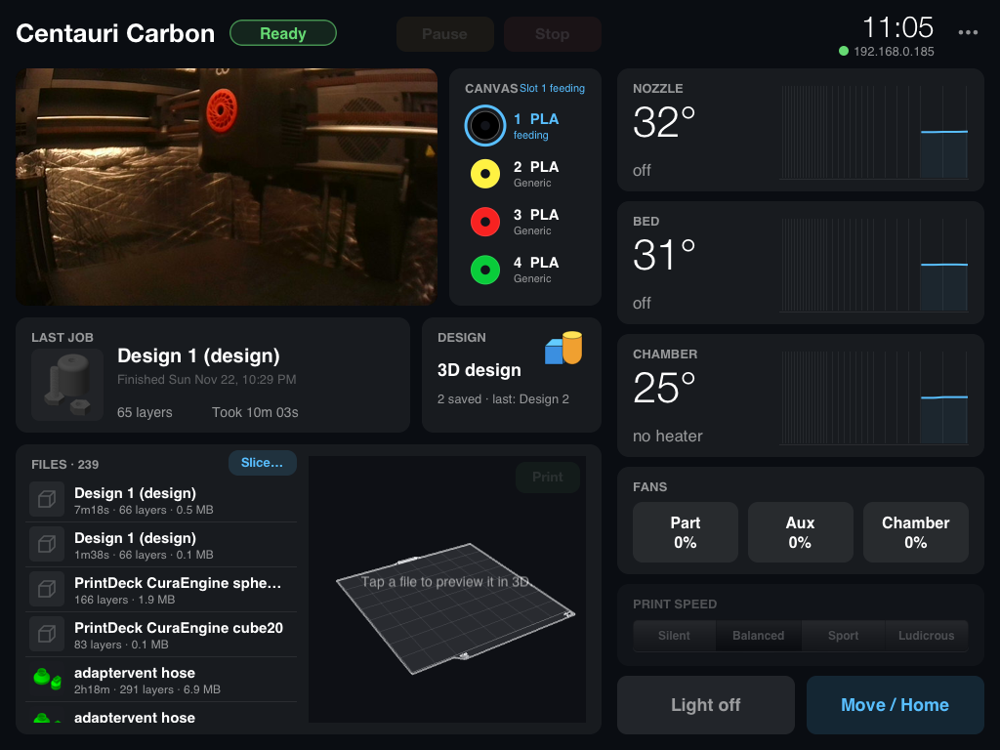
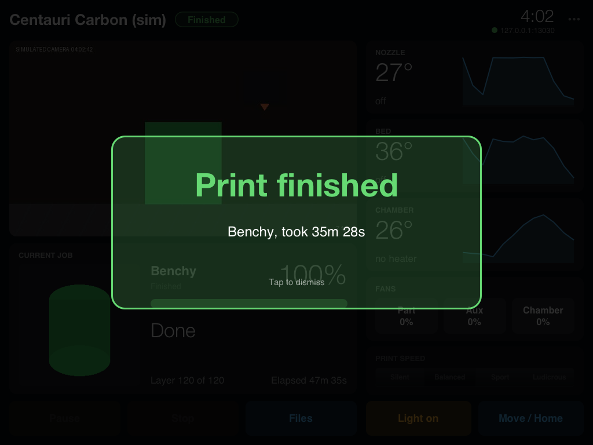

# PrintDeck

A live panel for an **Elegoo Centauri Carbon** (stock or OpenCentauri firmware) on the iPad 1 (iOS 5.1.1).
It shows the camera, the current job (thumbnail, %, layer, time left, finish time), nozzle/bed/chamber
temperatures with graphs, and fans. It lets you pause/resume/stop, start prints from the printer's file
list, set temperatures, fans, print speed and the light, and move/home axes. When a print finishes,
fails or pauses by itself, it shows a full-screen alert and plays a sound.



| Printing (simulator) | Finished alert (simulator) |
|---|---|
|  |  |

## How it works
```
Centauri Carbon (192.168.0.184)                            iPad: PrintDeck.app
  UDP 3000   "M99999" discovery  ◄──── broadcast on launch ── finds the printer by itself
  TCP 3030   SDCP websocket      ◄──── Cmd 0 status every 2 s; commands
  TCP 3031   /video MJPEG        ────► camera (~8 fps, 640x360)
  TCP 80     history thumbnails  ────► job picture
```
- **No computer needed.** The iPad talks to the printer directly over Wi-Fi, in plain HTTP/websocket, so iOS 5's
  old TLS doesn't matter.
- **Websocket by hand.** iOS 5 has no websocket API, and Safari 5.1 only speaks an old draft, so
  `PDWebSocket.m` implements RFC 6455 (handshake, masking, framing) over CFStream sockets.
- **Polling.** The printer doesn't push status while idle, so the app sends SDCP `Cmd 0` every 2 s. No reply
  for 8 s → reconnect. Brief Wi-Fi blips don't bring up the "offline" screen.
- **Camera.** JPEG frames are cut out of the MJPEG stream and decoded off the main thread. Frames that arrive
  while a decode is running are dropped, so the A4 never falls behind. The printer allows 4 video viewers at
  once; the app opens one and closes it when the iPad sleeps or the app is in the background.
- **Time left** blends the slicer's estimate with a progress-based one that takes over as the print goes on
  (on this printer a "2h18m" slice took 3h42m).
- The last printer found is remembered. The screen stays on, landscape, no status bar.

## Using it
- **Temperature cards** (nozzle, bed): tap for presets or a custom value. The chamber has no heater.
- **Fans**: tap Part / Aux / Chamber for 0–100 %.
- **Print speed**: Silent 50 %, Balanced 100 %, Sport 130 %, Ludicrous 160 % (Elegoo's presets; only while printing).
- **Files**: the printer's stored G-code, newest first; tap one to print it (asks first; disabled while busy).
- **Move / Home**: jog X/Y/Z by 0.1–50 mm and home; disabled while a job runs.
- **••• menu**: camera on/off (saves Wi-Fi and CPU), find printer, enter an address, reconnect.

## SDCP commands used
From [OpenCentauri's API notes](https://docs.opencentauri.cc/software/api) and the printer's own web UI (port 80),
checked against the printer (SDCP V3.0.0, firmware V1.4.49):

| Cmd | Use | Data |
|---|---|---|
| 0 / 1 | status / attributes | — |
| 128 | start print | `Filename`, `StartLayer` |
| 129 / 130 / 131 | pause / stop / resume | — |
| 258 | file list | `Url: "/local"` |
| 320 / 321 | history ids / task details (thumbnail URL, outcome, `ErrorStatusReason`) | `Id: [...]` |
| 401 | jog | `Axis`, `Step` (mm, negative = minus) |
| 402 | home | `Axis`: `X` `Y` `Z` `XYZ` |
| 403 | set | `TempTargetNozzle`, `TempTargetHotbed`, `PrintSpeedPct`, `TargetFanSpeed{ModelFan,AuxiliaryFan,BoxFan}`, `LightStatus{SecondLight,RgbLight}` |

`PrintInfo.Status` on this printer (from the web UI): 0 idle · 1, 15, 16 (heating), 18–21 (20 = leveling) preparing ·
13 printing · 5 pausing · 6 paused · 7 stopping · 8/14 stopped · 9 complete · 10 file check · 12 power-loss recovery.

Tested on the real printer: discovery, status, camera, files, history/thumbnail, and the light command (on/off
read back correctly). Pause/resume/stop/start, temperatures, fans, speed and moves were exercised against the
simulator only, since they would interrupt or start real prints. They use the same payloads as Elegoo's web UI.

## Build and install
```bash
cd apps/PrintDeck
make package install          # needs iproxy 2222 22 running (see DEV-NOTES.md)
```
URL scheme (handy over SSH: `ssh ipad "su mobile -c 'uiopen printdeck://…'"`):
`printdeck://connect?host=IP[&port=3030&video=3031]`, `printdeck://search`, `printdeck://camera?on=0|1`,
`printdeck://event?kind=finished|paused|failed` (preview the alert), `printdeck://snapshot`
(writes `/tmp/printdeck-snapshot.png` on the iPad).

## Simulator
`sim/printdeck_sim.py` is a fake Centauri Carbon (SDCP websocket, MJPEG camera, thumbnails). `sim/run-sim.sh` runs it on
this computer, carries it to the iPad over USB with SSH reverse tunnels, and points the app at it:
```bash
sim/run-sim.sh printing     # a job 35% in
sim/run-sim.sh finish       # ends ~25 s after the app connects → "Print finished"
sim/run-sim.sh runout       # pauses itself ~20 s in → "Print paused"
sim/run-sim.sh idle         # nothing printing; start one from Files
```
Afterwards, go back to the real printer with ••• → Find printer on Wi-Fi (or `printdeck://search`).
`sim/probes/` has the read-only Python probes used to work out the protocol (discovery; attributes/files/history).

Sounds are generated by `tools/make-resources.py`; the icon by `apps/tools/make-icons.py` (shared by all the apps).

## Security note
OpenCentauri leaves an unauthenticated root shell on TCP 4567 and documents a default root password for SSH.
Anyone on the Wi-Fi can take over the printer until you change the password and turn that shell off.

## Credits

Built by jeparks808 with Claude Code (Anthropic).
