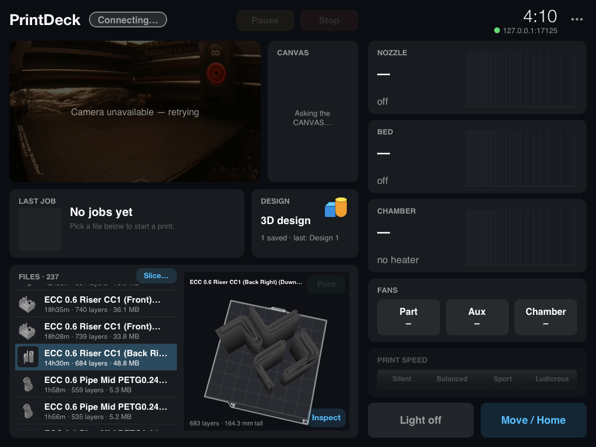

# Trying COSMOS on the Centauri Carbon

COSMOS is OpenCentauri's full firmware replacement for the CC1. It runs mainline Linux with Klipper and Moonraker,
and drives the CANVAS as AFC lanes. This page has three parts:
- how to try it while keeping a way back to the OpenCentauri patched firmware you run now (V1.4.49, OC 0.5.0);
- what the virtual COSMOS printer showed about PrintDeck;
- what PrintDeck needs before it can run on COSMOS.

Status (2026-11-22): PrintDeck now supports COSMOS (part 3). It has been tested on the iPad against the virtual
printer (`sim/cosmos_sim.py`), and SDCP still works with the real OpenCentauri printer. Nothing has been flashed.

## 1. Backup and rollback

### Before installing
1. **Back up the printer.** Run this, and type the printer's root password when asked (OpenCentauri's default is `OpenCentauri`, case sensitive; the user is `root`):
   ```bash
   tools/backup-printer.sh 192.168.0.185 --full
   ```
   - It writes to `~/printer-backups/<ip>-<date>/` and only reads from the printer.
   - Contents:
     - `system-info.txt`: partitions, the A/B boot environment and services.
     - `config-files.tar.gz`: `/board-resource` (including `user_printer.cfg` with your bed meshes and calibration), `/user-resource` (CANVAS `filament_info`) and `/etc`.
     - With `--full`, a gzip image of every eMMC partition. This is the last-resort restore over UART/FEL.
   - Without `--full` it takes a minute. With it, expect a long run over Wi-Fi.
2. **Keep the OpenCentauri firmware image.** It is already saved and checksummed:
   - `~/printer-backups/opencentauri-firmware/update.swu`
   - sha256 `f5eb6db1…d369`, built from Elegoo `FW-CentauriCarbon-v1.4.49`.
   - Its only other copy was in a temporary folder.
3. **Keep the USB stick from the install.** The COSMOS installer writes `ELEGOO.txt` to it, and you need that file to get back to stock Elegoo.
4. **Write down what you'd hate to lose**: Wi-Fi settings, Z offset, and the CANVAS slot colours (the dashboard shows them).
5. **Change the root password.** COSMOS has dropbear SSH. OpenCentauri's default password and its open shell on port 4567 are a risk on any Wi-Fi.

### Install (offline method, so you know exactly which image goes on)
Follow <https://docs.opencentauri.cc/klipper-conversion/cosmos/install/>:
1. Put the installer's `install_opencentauri` folder and the COSMOS `update.swu` (26.10.1 or newer) on a FAT32 stick.
2. On the printer, go to Files → USB → `install_opencentauri` → hold `IMPORT_ME_DO_NOT_PRINT` → Import.
3. Choose Install OpenCentauri → Install OpenCentauri From USB → Reboot.
4. **Do not power off during the first boot.** It flashes the toolhead and bed MCUs, which takes 5–10 minutes.
5. Afterwards, open `http://<printer>/` (Mainsail) and run `CHECK_CALIBRATION` → Calibrate All.

### Rolling back to OpenCentauri patched
- **Use COSMOS's own switch.** On the screen: Settings → **Switch to OC Patched**. Or run `switch-to-oc-patched` over SSH.
  - This is the only supported way back, because it also downgrades the toolhead and bed MCUs.
- **Never flash the OC (or Elegoo) `update.swu` directly from COSMOS.** The docs warn this skips the MCU downgrade and bricks the printer.
  - The saved `update.swu` is for re-patching **after** you are back on Elegoo firmware, or for recovery. Never use it as the COSMOS exit.
- **After switching back:**
  - Check `/board-resource/user_printer.cfg` and the CANVAS slots against the backup.
  - Restore files from `config-files.tar.gz` if they were reset. The docs don't say whether user data survives.
- **If it won't boot:**
  1. Try the docs' recovery: `emergency.swu` on USB, or `wpa_supplicant.conf` for Wi-Fi.
     See <https://docs.opencentauri.cc/klipper-conversion/cosmos/troubleshooting/recovery/>.
  2. If that fails, use UART/FEL with the `--full` partition images.
- **Stock Elegoo:** reverting to stock is not documented step by step for the CC1. Ask on the OpenCentauri Discord before relying on it.

## 2. What the virtual COSMOS printer showed

`sim/cosmos_sim.py` is a stand-in for a COSMOS printer:
- It serves Moonraker's HTTP and websocket API and an mjpg-streamer camera.
- It does **not** serve SDCP, the same as the real COSMOS.
- It uses the Klipper object names seen on a real COSMOS 26.10.1 + CANVAS printer: `AFC_lane CANVAS_1..4`, `temperature_sensor chamber`, `led case`.
- The `fan_generic` fan names are assumed.

`sim/cosmos_check.py` walks every PrintDeck feature against it:
```bash
python3 -I sim/cosmos_sim.py &          # add --scenario printing for a job in progress
python3 -I sim/cosmos_check.py          # 39 pass, 6 fail (the 6 below)
```
Against the real printer after flashing, run it read-only first (it only writes with `--write`):
```bash
python3 -I sim/cosmos_check.py --host <printer-ip> --port 80
```

**PrintDeck as it is today does not work on COSMOS.** All five of its SDCP paths are gone:

| PrintDeck today | On COSMOS |
|---|---|
| UDP 3000 discovery | nothing answers; the address must be typed in |
| SDCP websocket :3030 | connection refused |
| SDCP on Moonraker's `/websocket` (port 80) | handshake works, then every message gets JSON-RPC "Invalid Request" |
| Camera :3031/video | nothing there; the camera is `/webcam/?action=stream` |
| G-code at `/local/<file>` | 404; files are at `/server/files/gcodes/<file>` |

The unmodified app was run on the iPad against the virtual printer: 
- It stayed at "Connecting…", with no temperatures, camera or CANVAS data.
- Only the cached file list showed.

**Printing a PrintDeck-sliced file e-stops COSMOS.**
- The on-iPad slicer's start G-code (`PDSlicer.m`) has `M729` (Elegoo's nozzle clean) and `M6211`.
- COSMOS docs: M729/M8213 cause an emergency stop. The sim models this, and Klipper goes into SHUTDOWN at the start of the print.

**Every feature has a Moonraker equivalent, and all of them passed against the sim:**

| Feature | COSMOS / Moonraker |
|---|---|
| status, temps, job, position | `printer.objects.subscribe` pushes changes; no more 2 s polling |
| temperature graphs | `/server/temperature_store` (1 s samples, 20 min) |
| camera | `/webcam/?action=stream` MJPEG |
| files, details, thumbnails, G-code for the 3D view | `/server/files/list`, `/server/files/metadata`, `/server/files/gcodes/…` (Range works) |
| start / pause / resume / stop | `/printer/print/start|pause|resume|cancel` |
| temps, fans, light, home, jog | G-code via `/printer/gcode/script` (M104/M140, M106, SET_FAN_SPEED, SET_LED, G28, G91+G1) |
| upload from the Slice page | one multipart `POST /server/files/upload`; no MD5/chunk protocol |
| last job | `/server/history/list` |
| CANVAS slots (read) | `AFC_lane CANVAS_1..4` (colour, material, weight, loaded) |
| bed mesh | `bed_mesh` object; **meshbridge no longer needed** |

**New with COSMOS (SDCP never had these):**
- **CANVAS slot editing** (`SET_COLOR`, `SET_MATERIAL`, `SET_WEIGHT LANE=CANVAS_n`). Brand and filament name stay blank without Spoolman.
- **Z offset baby-stepping** (`SET_GCODE_OFFSET Z_ADJUST=`).
- **Motors off** (`M84`).
- **Extrude/retract.**
- **Re-probe the bed mesh** from the iPad (`BED_MESH_CALIBRATE`).
- **Any print speed %**, where SDCP only took 50/100/130/160.
- **Light brightness.**
- **A G-code console** (`/server/gcode_store`).
- **Every Klipper macro as a button.**

**Lost compared with OpenCentauri patched:**
- Elegoo's own touchscreen UI and Canvas screens; COSMOS has its own screen.
- Elegoo cloud and app.
- The chamber stays display-only. That is unchanged, since it has no heater.

## 3. PrintDeck on COSMOS

PrintDeck now supports COSMOS. Point it at the printer's IP as usual; no port is needed.
- **Detection:** on connect it asks `GET /server/info` on port 80.
  - A Moonraker answer switches that printer to COSMOS mode, and the top bar reads "<ip> · COSMOS".
  - Anything else keeps SDCP. The OpenCentauri printer answers 404, so nothing changes there.
  - UDP discovery can't find a COSMOS printer, so type its address once: ••• → enter an address.
- **How it works** (`PDPrinter.m`, "COSMOS" section):
  - It speaks Moonraker JSON-RPC on `ws://<ip>/websocket`.
  - It fills the same SDCP-shaped `status`, `attributes`, `files`, `lastTask`, `canvas` and `fileDetail` the pages already read, so no page needed changing for the existing features.
  - Every existing command becomes a Moonraker call or G-code: print start/pause/resume/cancel, M104/M140, M106, `SET_FAN_SPEED`, M220, `SET_LED`, G28, G91+G1.
  - Fan, LED, chamber-sensor and CANVAS-lane names are discovered from `printer.objects.list`.
  - Files keep `/local/<name>` paths inside the app. They're fetched from `/server/files/gcodes/`.
- **Camera:** `/webcam/?action=stream`.
- **Bed mesh:** read straight from Klipper's `bed_mesh`. Your meshbridge URL is put back when an SDCP printer is connected again.
- **Slice page:**
  - Upload is one multipart `POST /server/files/upload`.
  - On COSMOS, the start/end G-code drops M729, M6211, M749 and the G3 prime arc.
  - The light uses `SET_LED`, and the aux and chamber fans use `SET_FAN_SPEED` (Klipper's M106 has no `P` index).
  - Files sliced for COSMOS shouldn't be printed on SDCP firmware, and vice versa. Re-slice after switching.
- **New controls, COSMOS only:**
  - **Move / Home:** Motors off, Z −0.02 / Z +0.02 (baby-stepping with `SET_GCODE_OFFSET`), and **Restart firmware** after a Klipper shutdown.
  - The Motors tile shows whether the steppers are powered.
  - **CANVAS page:** tap a slot to set its material, then its colour (`SET_MATERIAL` / `SET_COLOR` on lane `CANVAS_n`).
- **Klipper shutdowns:** the status reads "Klipper shutdown" and an alert gives Klipper's message.

Checked on the iPad 1 against `sim/cosmos_sim.py`:
- dashboard (status, temperatures and graphs, chamber, camera, CANVAS, job with thumbnail, files with layers and pictures);
- Job page 3D toolpath; pause/resume; speed; light; cancel from the printer side (alert);
- Move / Home (home, jog, Z offset, preheat, motors off);
- CANVAS slot edit; bed mesh;
- shutdown alert and Restart firmware;
- slice + upload; the uploaded file prints without a shutdown.

Not checked yet:
- a real COSMOS printer. The real object names and Moonraker's exact replies may differ: run `sim/cosmos_check.py` against it first.
- extrude/retract, which isn't added.

Developer aid: `printdeck://lane?slot=N` opens slot N's picker on the CANVAS page.
