# What PrintDeck adds

The Centauri Carbon comes with two ways to watch and control it away from its touchscreen:

- **The printer's own web page** (`http://<printer>/`, port 80, firmware 1.4.x). It shows the status, camera,
  temperatures as numbers, fans, speed, light, files with their thumbnails, history and time-lapse videos, the
  CANVAS slots, and axis jog/home. You can start, pause and stop prints there.
- **ElegooSlicer** on a desktop computer. It slices and previews G-code, and its Device tab shows the printer.

PrintDeck does all of that from one iPad 1 screen and adds things that neither of them has. This page lists those
additions, with screenshots from the iPad connected to a real printer.

The claims about the web page come from reading its shipped Angular bundle. It knows these SDCP commands: status,
start/pause/stop/resume, power-loss recovery, rename, file list/detail/delete, history and history video,
CANVAS material data, video streaming, the time-lapse switch, axis move/home, and the temperature, fan, speed
and light settings. It has no chart library, no 3D or G-code viewer, no bed mesh view and no slicer.

## At a glance

| Feature | Printer web page | ElegooSlicer | PrintDeck |
|---|:---:|:---:|:---:|
| **3D bed mesh with corner-screw tramming hints** | — | — | ✅ |
| **Live 3D toolpath of the running job, current layer highlighted** | — | — | ✅ |
| **3D preview of files already on the printer, with a layer slider** | thumbnail only | only files you open in it | ✅ |
| **Temperature history graphs** (min / max / average) | numbers only | numbers only | ✅ |
| **Full-screen finished / failed / paused alert with sound** | — | — | ✅ |
| Motor driver status, Z offset and status tiles beside the jog controls | — | — | ✅ |
| File details: footprint on the bed, size, height, upload date, last printed | partly | — | ✅ |
| Slicing | — | ✅ (desktop) | ✅ **on the iPad** |
| 4 CANVAS slots, **From CANVAS** fill-in, flushing table | — | ✅ | ✅ |
| Print options (plate type, time-lapse, bed levelling) when sending a print | at the printer | ✅ | ✅ |
| 3D modeller with threaded bolts, nuts, holes and gears | — | — | ✅ |
| Handy test models | — | ✅ | ✅ (in the modeller) |
| Works without a desktop computer, on a 2010 tablet | needs a browser | needs a PC | ✅ |

"—" means the feature isn't there. "Partly": the web page's file detail shows the slicer's estimates but not where
the part sits on the bed.

---

## Bed mesh in 3D ⭐

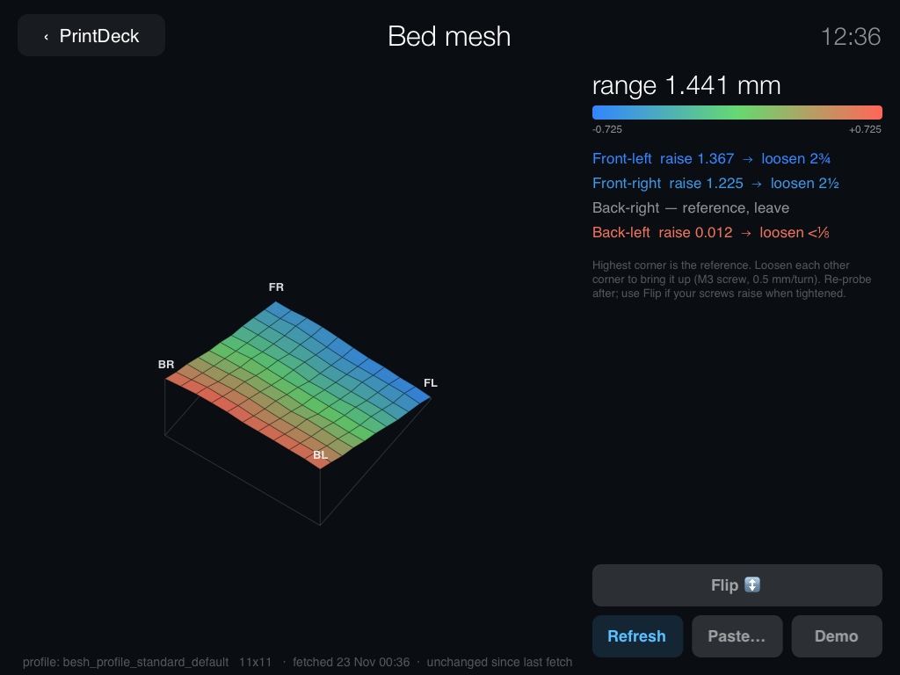

**Not available in the printer's web page or in ElegooSlicer.** The web page only reports that levelling ran.
The firmware has no command that returns the mesh.

- A rotatable 3D height map of the probed grid (11 × 11 here), coloured blue → green → red around the mean, with
  the total range (1.441 mm on this bed).
- **Tramming hints** for the four spring-loaded corner screws. The highest corner is the reference. For every
  other corner it shows how much it must rise and how far to turn the screw: "raise 1.367 → loosen 2¾" for an M3
  screw at 0.5 mm per turn. **Flip** swaps loosen and tighten if your screws work the other way round.
- The footer says where the mesh came from and when ("fetched 23 Nov 00:36 · unchanged since last fetch"). The
  page fetches again on its own about 8 s after the printer finishes levelling.
- **How it gets the mesh:** a tiny helper, `meshbridge`, runs on the printer. It reads the saved Klipper
  `[bed_mesh]` profiles and serves them on port 7140. `tools/install-meshbridge.sh` installs it so it starts at
  every boot (OpenCentauri firmware). You can also paste a mesh, or use a COSMOS printer's Moonraker directly. See
  [Bed mesh](../README.md#bed-mesh).

## Main page

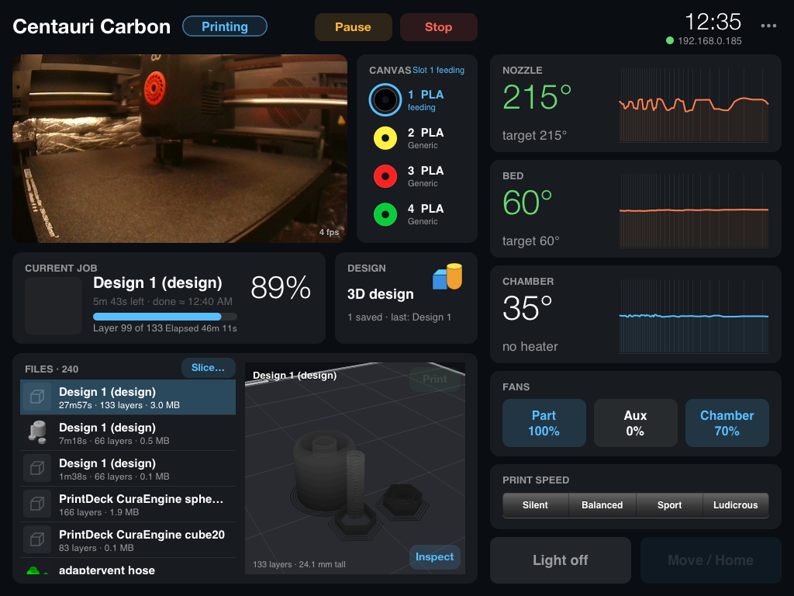

Everything on one screen, refreshed live: camera, the CANVAS slots (the one feeding is ringed), the current job
with time left and **finish time**, the Design card, the file list with a **3D preview**, and nozzle, bed and
chamber temperatures with **live graphs**. The bottom right has fans, print speed and the light. Every card opens
a full-screen detail page.

## Live 3D toolpath of the running job ⭐

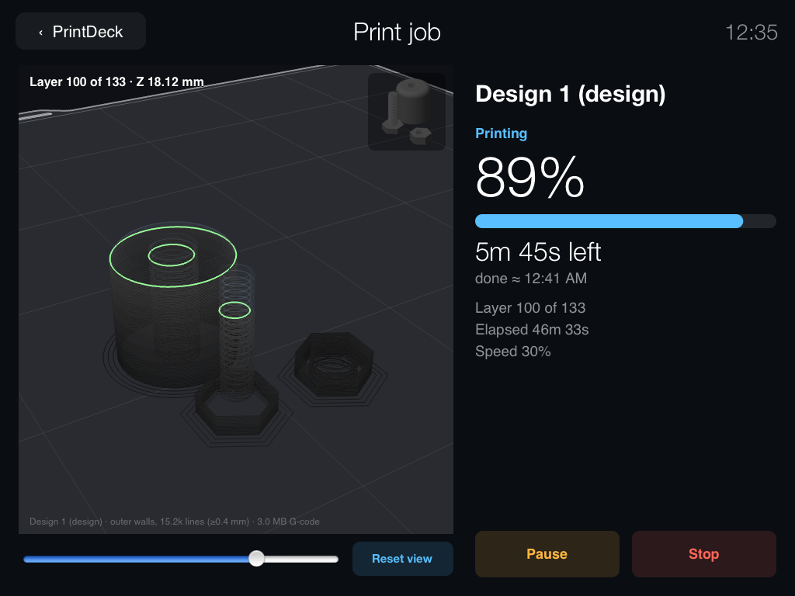

**Not in the web page, and ElegooSlicer can't follow a print in progress.** The Job page downloads the G-code of
the running job from the printer and draws it in 3D on the real Centauri Carbon plate:

- the layers already printed, in the **filament's own colours** (each CANVAS colour of a multi-colour file);
- the layer printing now, in bright green;
- the layers still to come, as a faint ghost.

Drag to rotate, pinch to zoom, or use the layer slider to step through the part. It runs at about 21 fps on the
iPad 1.

## Files: 3D inspection of what's on the printer ⭐

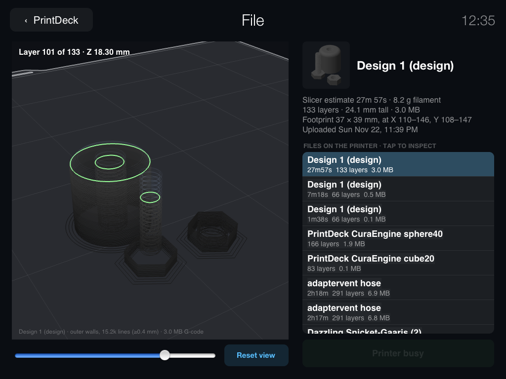

The web page lists files with a thumbnail. PrintDeck shows each file **in 3D** and lets you step through its
layers. The **Inspect** page also shows the slicer's estimates, layers, height, size, the part's **footprint on
the bed**, the upload date and when it was last printed, and has **Print this file**. A file the printer hasn't
printed yet still gets a picture: PrintDeck reads the slicer's thumbnail from the G-code header. Parsed toolpaths
are cached, so a file opens instantly the second time.

## Temperature graphs ⭐

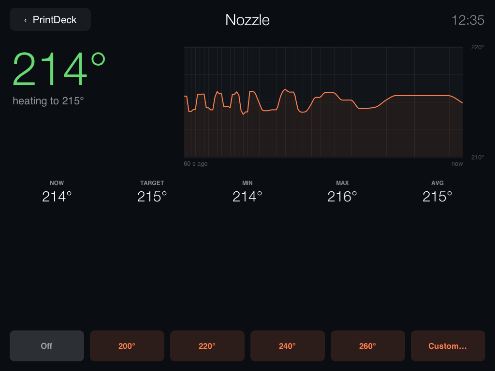

The web page and the slicer show the current temperatures. PrintDeck keeps a **graph of the last minute** with
the current reading, target, minimum, maximum and average, so you can see a PID wobble or a bed that sags when
the fan kicks in. It also has quick presets.

## Finish, failure and pause alerts ⭐

| Printing | Finished |
|---|---|
| 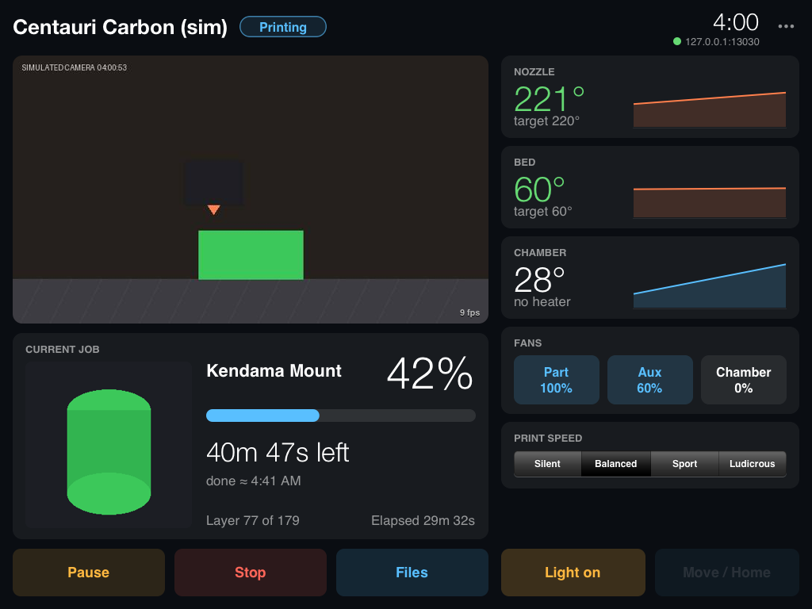 | 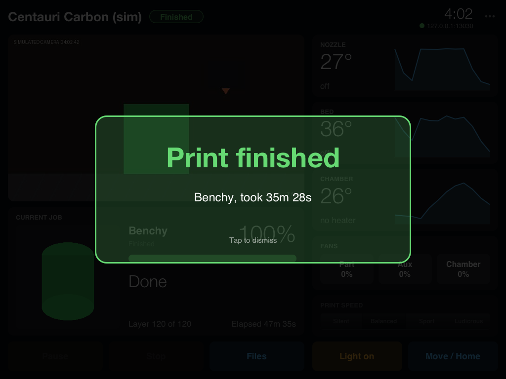 |

When a print finishes, fails or pauses by itself (a filament runout, for example), PrintDeck shows a full-screen
alert and **plays a sound**. Leave the iPad on a shelf and you hear it from across the room. The web page has no
alerts.

## Move / Home with live status

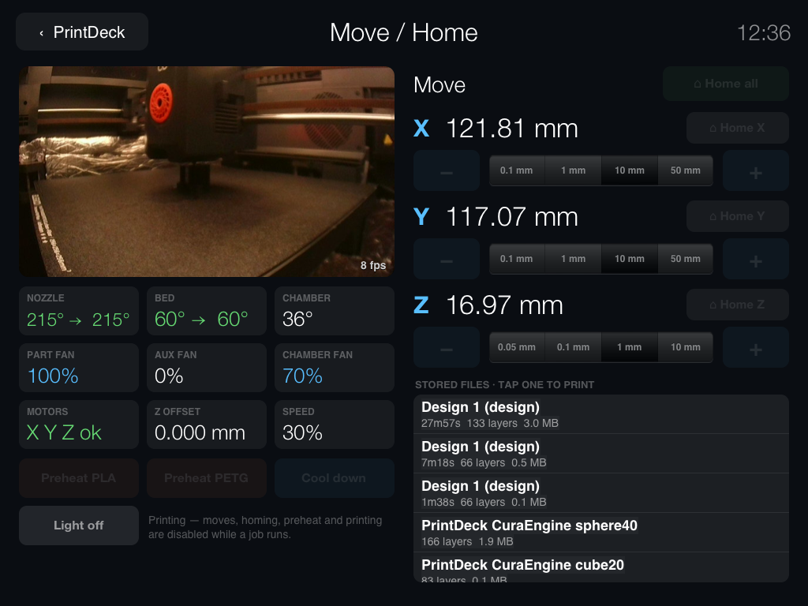

The live camera sits beside the jog controls, so you see the head move. Each axis has its own step sizes. Status
tiles show temperatures, fans, **motor driver status** (asked from the printer every 6 s), Z offset and speed.
There are also Preheat PLA / PETG and Cool down buttons.

## CANVAS

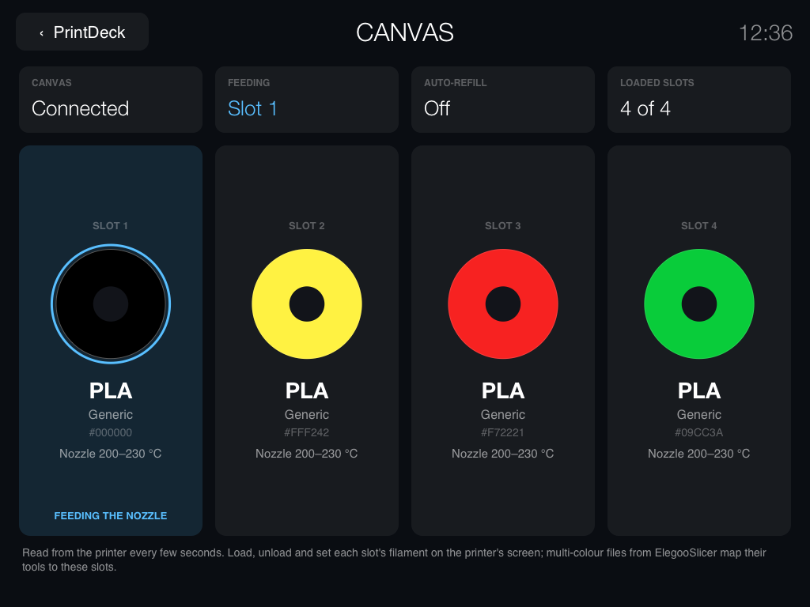

A big tile per slot: spool colour, type, brand, hex colour, nozzle range, and which slot is feeding the nozzle.
Below them are the connected, feeding, auto-refill and loaded states.

---

## Slicer, on the iPad ⭐

PrintDeck slices STL files **on the iPad itself** (CuraEngine 15.04, cross-compiled for the iPad 1's A4). It
uses ElegooSlicer's stock Centauri Carbon profiles and the presets you saved in ElegooSlicer or OrcaSlicer. The
printer reads its layer count, time and weight like any ElegooSlicer file.

| Prepare: four CANVAS slots | Settings, laid out like Orca |
|---|---|
| 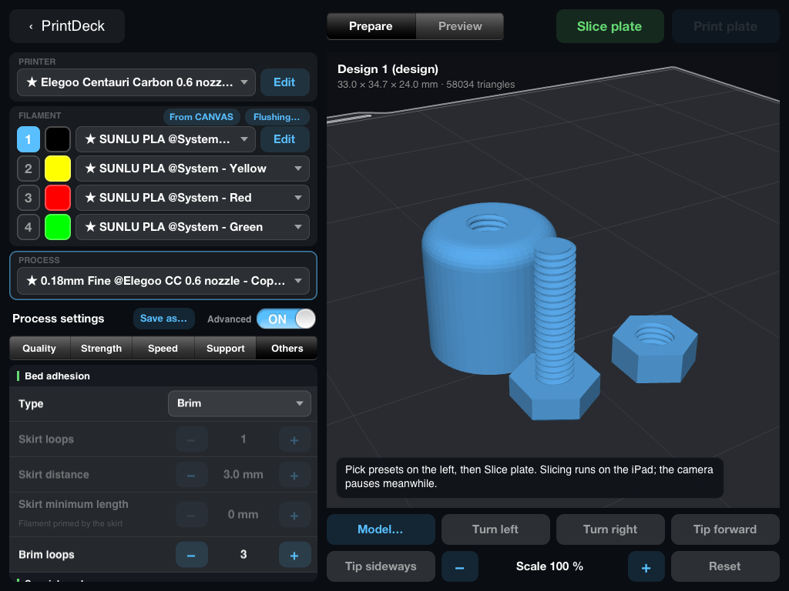 | 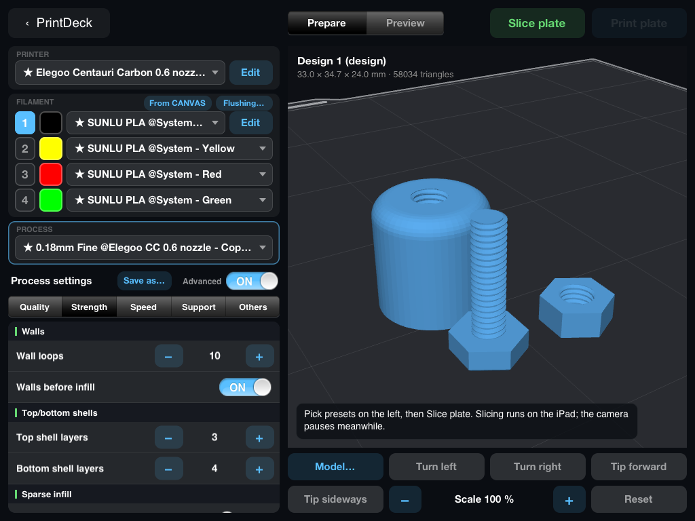 |

- **Four filament slots**, one per CANVAS slot, each with a colour and a filament preset. Tap a number to print
  from that slot. **From CANVAS** copies the loaded spools' types, colours and names from the printer.
- Settings are grouped under Quality, Strength, Speed, Support and Others, with an **Advanced** switch. Gyroid
  infill is PrintDeck's addition to the engine.

| Flushing volumes | Print options |
|---|---|
| 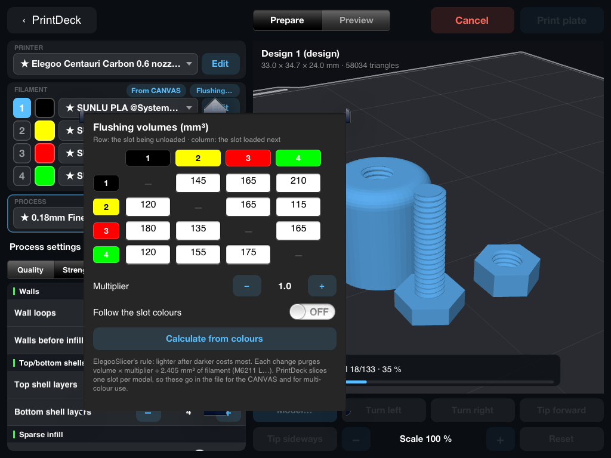 | 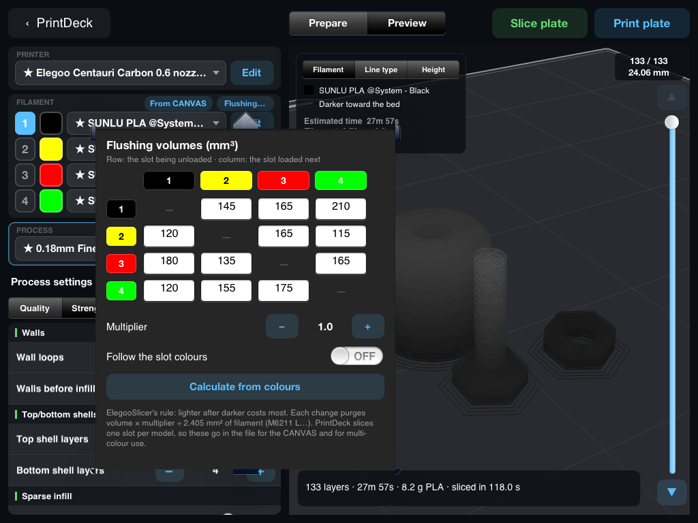 |

- **Flushing…** is ElegooSlicer's purge-volume table. **Calculate from colours** uses ElegooSlicer 1.5.3.5's own
  rule, recovered from its binary.
- **Print plate** opens **Print options**: plate type (Textured or Smooth PEI), time-lapse and auto bed levelling.
  These are the choices the printer's own start screen offers, and they're remembered. Then choose **Print** or
  **Upload only**.

| Preview in the filament colour | Preview by line type |
|---|---|
| 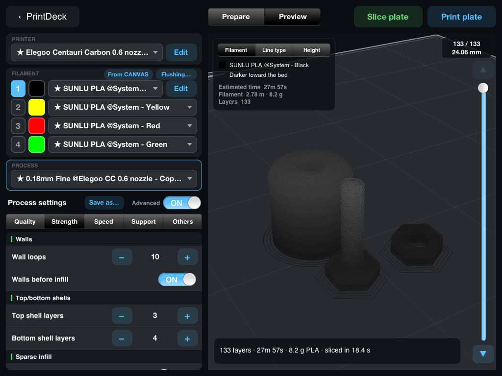 | 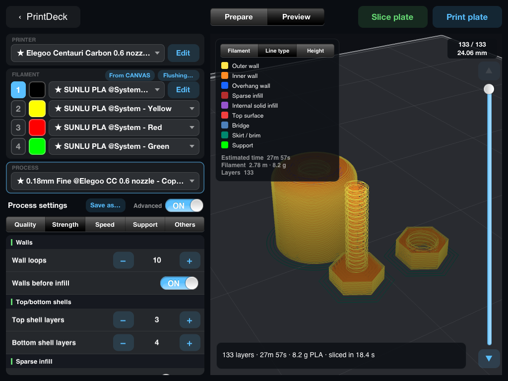 |

The Preview tab shows the sliced result in the filament colour, by line type (with Orca's legend) or by height,
with a layer slider and the totals. A 40 mm sphere slices in about 12–14 s on the iPad 1.

## Design: a 3D modeller ⭐

**Not part of the web page or the slicer.** A Tinkercad-style modeller in native OpenGL ES; tinkercad.com itself
needs WebGL, which iOS 5 doesn't have.

| Scale mode with a threaded bolt, nut and cap | Handy test models |
|---|---|
| 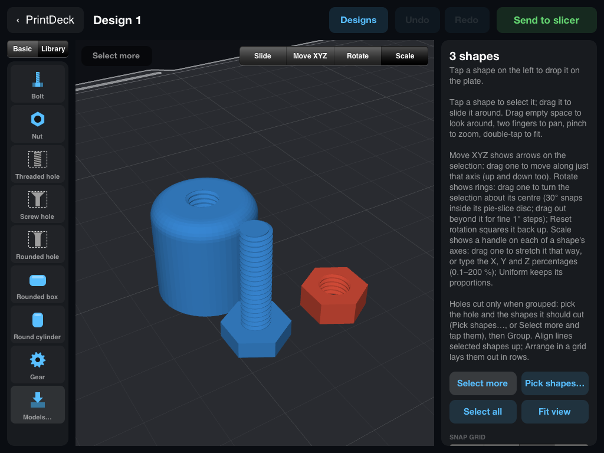 | 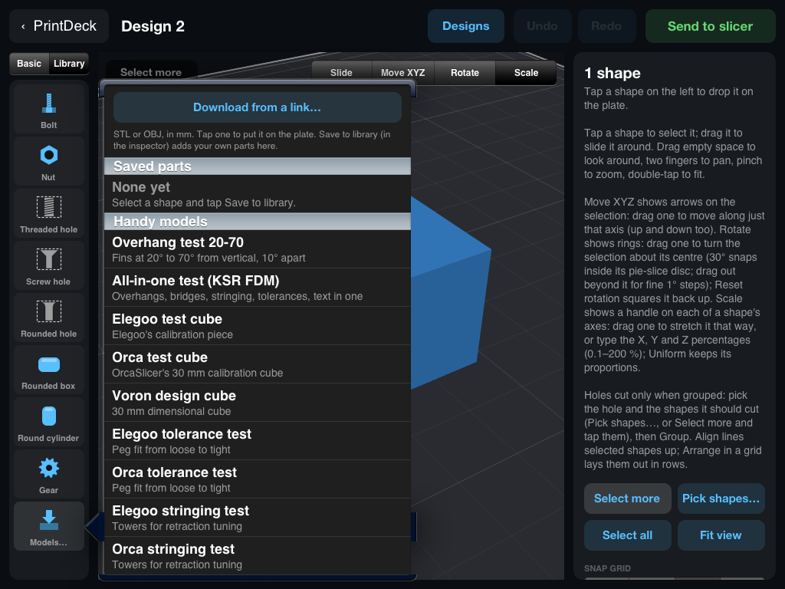 |

- **Basic shapes**, including holes, with fillet and chamfer options.
- A **parametric library**: ISO metric bolts and nuts (M2–M12, threaded), threaded, screw and rounded holes,
  rounded boxes and cylinders, and involute gears.
- **Holes cut when grouped**, using a watertight CSG that runs in the background with a progress bar.
- **Slide / Move XYZ / Rotate / Scale** tools with rulers, a protractor and typed values. There is also Align,
  Space evenly, Arrange in a grid, and Undo/Redo.
- **Handy models**: an overhang test, an all-in-one test, the Elegoo, Orca and Voron cubes, tolerance and
  stringing tests, Calicat and the Stanford bunny. They sit between your saved parts and the models on the iPad.
- **Send to slicer** passes the design straight to the Slice page. Designs made this way have printed on the real
  printer.

---

## Other conveniences

- **Busy printer handling.** While a print is being prepared or running, the printer refuses file downloads
  (HTTP 500). PrintDeck says so and loads the preview by itself as soon as the printer allows it.
- **Clear local cache…** in the ••• menu frees thumbnails, parsed toolpaths and slicer scratch files.
- **COSMOS (Klipper + Moonraker) support**, detected automatically; see [COSMOS.md](COSMOS.md).
- **Runs on an iPad 1** (iOS 5.1.1, 256 MB RAM) at about 18 MB of memory: an old tablet becomes a dedicated
  printer panel.
